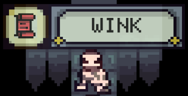
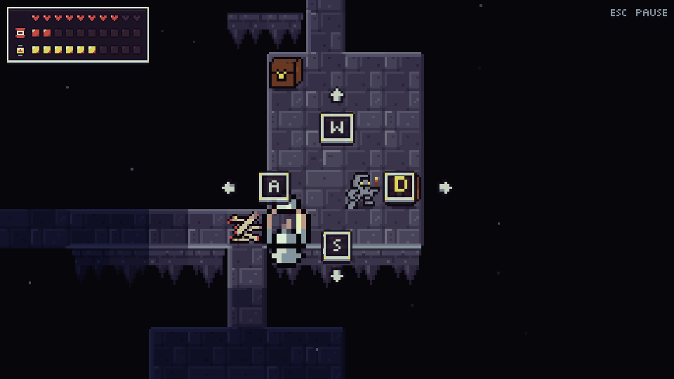
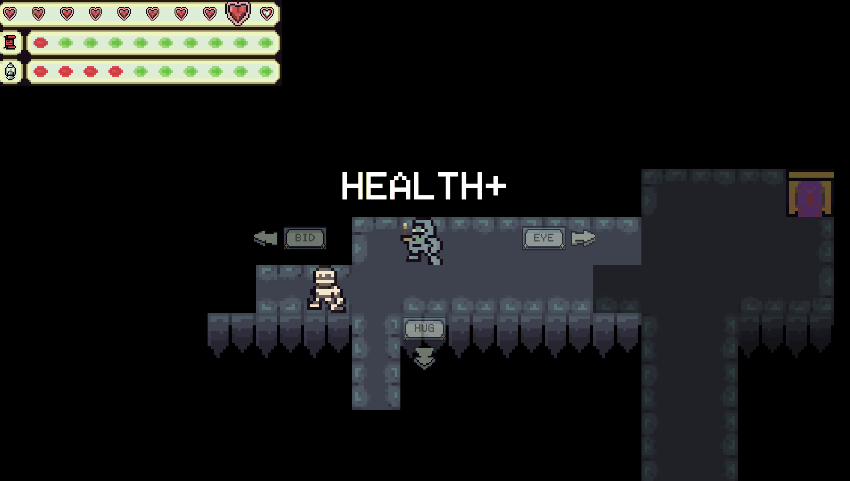
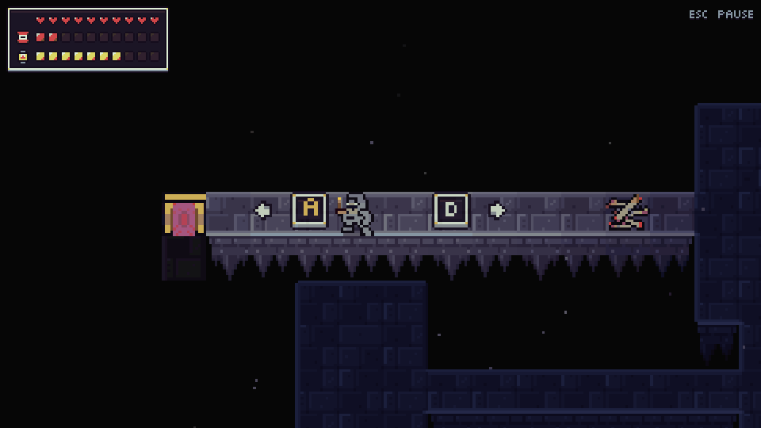
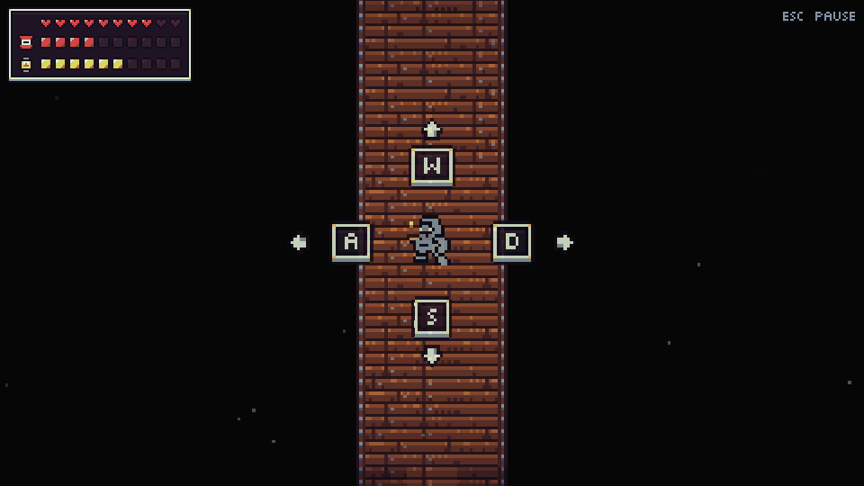

Dungeon Scrawl is a rogue-like typing-tutor game where you traverse a dungeon while slaying enemies and acquiring loot! As you get deeper, the dungeon grows stronger and stronger.. can you get to the bottom? (Hint: It's at level 5)

Made for Ludum Dare 41. Theme: **Combine 2 Incompatible Genres**

https://ldjam.com/events/ludum-dare/41/dungeon-scrawl

# How to Play

Simply type the words in the prompts on the screen to perform your actions!

Acquire loot to get stronger!

Fight enemies with brute force and magic!

Traverse deeper, and fight dangerous enemies!

Can you get to the end of the dungeon? (Hint: It's at level 5)

# Known Bugs

There is a bug where sometimes the prompts are displaying, but when typing a word nothing happens. Usually walking in the opposite direction fixes it. If it doesn't, I'm sorry.
